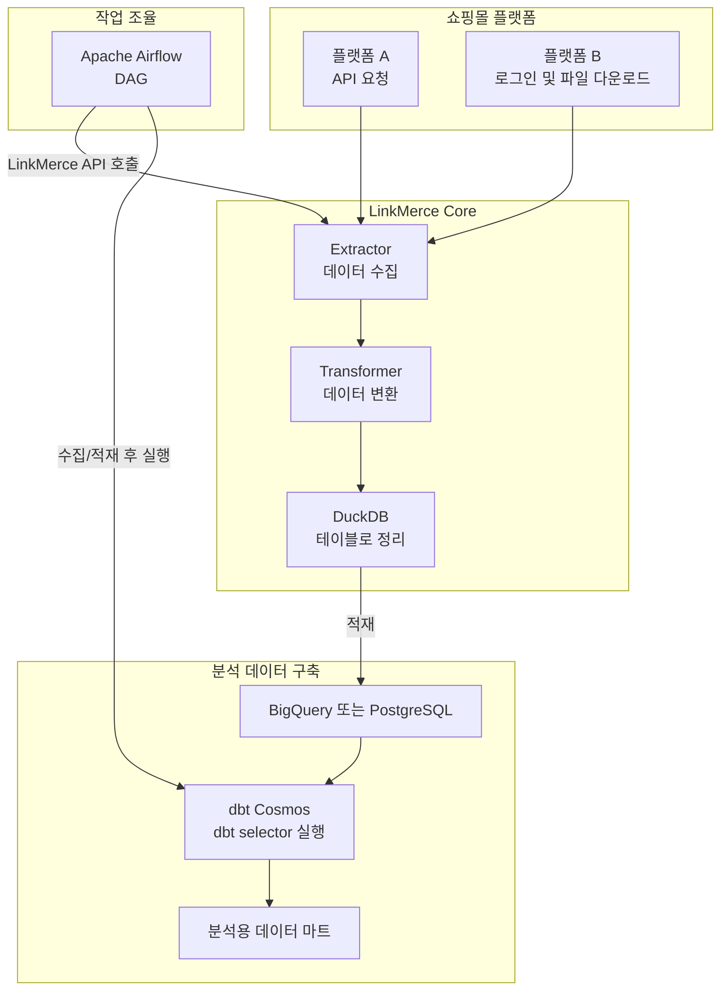
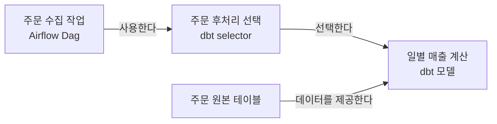
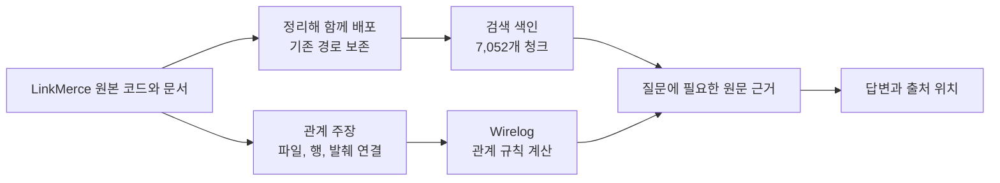

{}
<i class="icon-magic"></i> **AI 요약 & 가이드**

LinkMerce의 데이터 수집 및 변환 흐름을 바탕으로,
프로젝트의 구성요소와 관계를 온톨로지로 정의하고 Wirelog 규칙으로 계산하는 과정을 설명합니다.
코드와 문서의 근거를 지식 자료로 연결해 질문에 답하는 방식과,
Docker로 앱을 실행해 관계를 철회하고 복원하는 과정도 함께 살펴봅니다.

- **[LinkMerce 프로젝트 개요](#linkmerce-프로젝트-개요)**: 쇼핑몰 데이터가 수집 및 변환되어 분석용 데이터로 이어지는 흐름을 알아봅니다.
- **[온톨로지 이해하기](#온톨로지-이해하기)**: 프로젝트의 대상과 관계를 어떤 의미와 타입으로 표현하는지 살펴봅니다.
- **[Wirelog로 계산하기](#wirelog로-계산하기)**: 사실과 규칙으로 관계를 도출하고, 사실을 철회했을 때 결과가 달라지는 이유를 설명합니다.
- **[지식을 담는 방법](#지식을-담는-방법)**: 관계 정의와 코드 및 문서의 출처 근거를 함께 관리하는 구조를 소개합니다.
- **[질문을 처리하는 과정](#질문을-처리하는-과정)**: 질문에 맞는 관계와 원문 근거를 찾아 답변으로 구성하는 흐름을 정리합니다.
- **[직접 실행해보기](#직접-실행해보기)**: Docker로 LinkMerce Atlas를 실행하고 관계 철회 실험을 확인합니다.
{}

"2026 오픈소스 AI SW 활용 인재 양성 특화형 과정"에 참여하여 온토롤지에 대해 배웠습니다.
구체적인 과정명은 "Wirelog Neuro-Symbolic Agent Lab"라고 하여 Wirelog라는 규칙으로
온톨로지를 구축하는 방법에 대해 알아볼 수 있는 기회가 되었습니다.

온톨로지가 무엇인지 모른 상태에서 과정에 참여하기 전에는, 제가 다니는 쇼핑몰 회사에서 활용하기 위해
자사 상품과 연관성 있는 경쟁사 상품들의 정보를 연결시켜서 매출을 끌어올릴 수 있을만한
요소들을 파악하는 프로젝트를 하려고 했습니다.

하지만, 사실들 간에 규칙을 작성해 연결하는 Wirelog의 표현법을 배우면서
짧은 시간에 다양한 종류의 경쟁 상품 정보에서 규칙을 만들어 내는게 어려울 것이라 생각하여,
제가 개발해왔고 잘 알고 있는 개인 프로젝트의 구조를 온톨로지로 만들어 보기로 했습니다.

## LinkMerce 프로젝트 개요

이 과정을 위해 만든 LinkMerce Atlas는 제가 개발한 LinkMerce의 구성요소와 데이터 흐름을
온톨로지와 Wirelog로 표현한 독립형 웹 애플리케이션입니다.
프로젝트의 코드와 문서에서 만든 지식 자료를 탐색하고, 관계 질의와 근거 확인을 할 수 있으며,
LinkMerce 라이브러리나 운영 데이터베이스에 연결하지 않아도 실행할 수 있습니다.
저장소에는 앱을 실행하는 방법과 지식 자료가 함께 들어 있습니다.



온라인으로 상품을 판매한다면 네이버, 쿠팡, G마켓 등 여러 쇼핑몰 플랫폼에 상품을 진열하여
다양한 고객들의 유입을 이끌어 낼 필요가 있는데,
이런 플랫폼들에서 발생하는 데이터를 자동화된 프로세스를 통해 가져오기 위한 목적으로
제가 만들어 오던 것이 LinkMerce 프로젝트입니다.

이제 LinkMerce 프로젝트로 구현한 내용을 간략히 설명하겠습니다.
원본 프로젝트의 소스코드는 아래 저장소에서 확인할 수 있습니다.



### 데이터 수집 및 변환 과정

여러 쇼핑몰 플랫폼에서 상품을 판매하면 주문 내역이 각 플랫폼에서 독자적인 양식으로 발생합니다.
어떤 플랫폼은 API로 주문 내역을 제공하기도 하지만, 그러한 편의 기능을 제공하지 않아
직접 로그인해 엑셀 파일로 다운로드해야하는 경우도 있습니다.

LinkMerce의 core 로직은 API 요청 또는 로그인 후 쿠키/토큰을 활용한 백엔드 API 요청 등
다양한 방식으로 쇼핑몰 플랫폼에서 상품 판매와 관련된 데이터를 가져오는 기능을 구현합니다.
그리고, 응답 결과를 일반적으로는 JSON 포맷으로 파싱하고 DuckDB를 사용하여 관계형 테이블에 기록합니다.

ETL 프로세스를 중심으로 하기에 데이터 수집 부분은 `Extractor`, 데이터 변환 부분은 `Transformer`
라는 명칭으로 정의했고, 이 둘을 연쇄적으로 호출해 데이터 수집부터 변환까지 일괄 수행하는 API를 만들었습니다.

스케줄에 맞춘 자동화된 작업 처리는 Apache Airflow에서 담당합니다.
ETL 파이프라인을 구현한 각각의 Dag은 내부적으로 LinkMerce API를 호출해 원하는 쇼핑몰 데이터를
DuckDB로 가져오고, 그것을 BigQuery 또는 PostgreSQL로 적재하는 역할을 처리합니다.

ELT 파이프라인이 완료되면 dbt Cosmos를 사용해 특정 dbt selector를 실행합니다.
이를 통해 DuckDB로 가져온 원천 데이터를 BI 대시보드에서 참조하기 용이한 데이터 마트로 변환합니다.

이 과정을 그래프로 표현하면 다음과 같습니다.



### LinkMerce 프로젝트 구조

앞에서 설명한대로 LinkMerce에는 여러 기술이 함께 등장합니다.
먼저 각 명칭을 이 처리 흐름에 맞춰 정리하겠습니다.

| 이름 | 프로젝트에서 맡은 역할 |
| --- | --- |
| Core | 데이터를 가져오고 가공하는 핵심 Python 코드 묶음입니다. |
| LinkMerce API | Core 기능을 다른 코드에서 호출하기 쉽게 제공하는 Python 함수입니다. |
| DuckDB | 수집한 자료를 정리할 때 사용하는 중간 처리용 데이터베이스입니다. |
| BigQuery/Postgres | 가공한 자료를 보관하고 분석하는 데이터 저장소입니다. |
| Airflow | 작업을 언제, 어떤 순서로 실행할지 관리하는 도구입니다. |
| dbt | 저장된 자료를 SQL로 가공하고, 가공 작업 사이의 참조 관계를 관리하는 도구입니다. |

이 글에서 SQL은 저장된 자료를 조회하고 가공하는 언어 정도로 이해하면 됩니다.
그리고 이후에 자주 사용할 세 가지 용어를 조금 더 설명하겠습니다.

1. **Airflow Dag**은 실행할 작업과 그 순서를 묶어 정의한 것입니다.
   예를 들어 [ 주문 수집하기 → 엑셀로 가공하기 → 보고서 전송하기 ] 라는 작업 구성을 만들 수 있습니다.
   Dag은 이런 실행 설계이며, 어느 날 실제로 실행된 한 번의 결과와는 구분됩니다.

2. **dbt 모델**은 자료를 가공하는 SQL 정의입니다.
   "주문을 날짜별로 묶어 매출을 합산한다"는 계산을 하나의 모델로 만들 수 있습니다.

3. **dbt selector**는 실행할 모델을 고르는 선택 규칙입니다.
   모델이 많으면 매번 전부 실행하기보다 "주문을 수집한 뒤 필요한 계산들"처럼 일부를 묶어 선택할 필요가 있습니다.
   이 글에서 selector라고 하면 바로 이 **dbt의 모델 선택 규칙**을 뜻합니다.

### 프로젝트에 대한 예상 질문

이제 새로운 개발자가 LinkMerce 개발 및 유지보수를 맡게 되었다고 생각해보겠습니다.
아마 다음과 같은 질문부터 하게 될 것입니다.

- 네이버 스마트스토어 주문 자료는 어디에서, 어떤 방식으로 가져오나요?
- 주문 수집이 끝나면 어떤 매출 계산 모델을 실행하나요?
- 일자별 이익 계산 시 어떤 판매처의 매출과 어떤 플랫폼의 광고비가 들어가나요?
- 이 설명을 실제로 확인할 수 있는 코드나 문서는 어디에 있나요?

답은 파일 하나에 모여 있지 않습니다.
자료를 가져오는 Python 코드, 실행 순서를 정한 Airflow 파일, 모델을 고르는 dbt 설정,
그리고 계산을 정의한 SQL을 함께 읽어야 합니다.

LinkMerce Atlas가 설명하려는 것은 이런 **프로젝트의 구성과 연결**입니다.
"오늘 주문이 몇 건인가요?"처럼 실제 DB의 숫자를 조회하는 도구와는 다릅니다.

## 온톨로지 이해하기

### 종류와 대상

저는 온톨로지를 **다루려는 대상의 종류와, 대상 사이 관계의 의미를 정하는 약속**으로 이해했습니다.
LinkMerce Atlas에서는 "수집 작업", "dbt 모델", "dbt selector", "데이터 테이블", "근거 문서" 등을 구분합니다.

이해를 위해 다음과 같은 작은 상황을 가정해보겠습니다.
이후 규칙과 증분 설명에서도 이 예제를 이어서 사용하겠습니다.
아래 이름들은 실제 소스의 식별자가 아니라 **역할을 쉽게 읽기 위한 설명용 이름**입니다.

| 설명용 대상 | 대상의 종류 |
| --- | --- |
| 주문 수집 작업 | Airflow Dag |
| 주문 후처리 선택 | dbt selector |
| 일별 매출 계산 | dbt 모델 |

"Airflow Dag"은 대상의 **종류**, "주문 수집 작업"은 그 종류에 속한 **개별 대상**입니다.
온톨로지에서는 각각 타입과 개체라고 부릅니다.

종류 사이에도 관계를 정할 수 있습니다.
예를 들어 "Core 모듈은 Python 모듈의 한 종류"라고 정의하면, 개별 Core 모듈도 Python 모듈로 분류할 수 있습니다.
Wirelog는 이런 타입 상속도 계산합니다.

실제 LinkMerce Atlas는 15개 타입을 정의합니다.
같은 이름의 매출 계산 모델이 Postgres와 BigQuery에 따로 있으면, 이름에 저장소 구분도 포함해 서로 다른 대상으로 다룹니다.

### 관계에 의미 붙이기

앞의 세 대상을 선으로만 연결하면 무엇을 뜻하는지 알기 어렵습니다.
따라서 선에도 "무엇을 사용하는가", "무엇을 선택하는가"라는 의미를 붙입니다.

```text
주문 수집 작업
    ↓ 주문 후처리에 사용할 선택 규칙을 지정한다
주문 후처리 선택
    ↓ 실행할 계산 대상으로 고른다
일별 매출 계산
```

이 그림은 "주문 수집 작업의 후처리 설정에서 일별 매출 계산을 선택한다"는 뜻입니다.
중간에 dbt selector를 둔 이유는 **수집 작업에 모델 하나를 직접 고정하는 대신 선택 규칙을 거쳐 필요한 모델들을 고르기 때문**입니다.
설명에서는 모델을 하나만 넣었지만, 실제 selector는 여러 모델을 선택할 수 있습니다.

LinkMerce Atlas에서 두 선에 붙인 관계 이름은 다음과 같습니다.

| 관계 이름 | 관계 설명 |
| --- | --- |
| `runs_selector` | 이 Dag에 해당 dbt selector를 사용하는 작업이 정의되어 있다. |
| `selects_model` | 이 dbt selector가 해당 dbt 모델을 선택한다. |

데이터를 참조하는 관계는 또 다른 의미입니다.
예를 들어 "일별 매출 계산이 주문 원본 테이블을 읽는다"는 관계와
"주문 수집 작업이 후처리 선택 규칙을 사용한다"는 관계를 같은 것으로 취급하면 안 됩니다.

방향도 정해야 합니다. LinkMerce Atlas의 데이터 의존 관계는 출처에서 그것을 사용하는 쪽으로 저장합니다.
그래서 "주문 원본 → 일별 매출 계산"은 뒤의 계산이 앞의 자료를 참조한다는 뜻입니다.
"일별 매출 계산의 출처는 무엇인가요?"라는 질문에서는 이 연결을 반대로 따라갑니다.



위쪽 흐름은 **어떤 작업이 어떤 계산을 실행하는가**를 나타내고, 아래쪽 화살표는 **계산이 어떤 데이터를 읽는가**를 나타냅니다.
화살표가 모두 같은 종류의 연결이 아니라는 점이 핵심입니다.

### 연결의 조건 정하기

관계의 의미를 정했다면, 어떤 종류의 대상끼리 연결할 수 있는지도 정합니다.

"dbt selector를 사용하는 작업"이라는 관계의 출발점은 Airflow Dag, 도착점은 dbt selector입니다.
주문 원본 테이블을 그 자리에 넣어 "테이블이 selector를 실행한다"고 입력하면 종류가 맞지 않습니다.

관계의 출발 타입과 도착 타입을 각각 <b>정의역(domain)</b>과 <b>치역(range)</b>이라고 부릅니다.
이런 조건은 그럴듯한 이름의 연결을 무조건 받아들이지 않도록 하는 기준입니다.

LinkMerce Atlas는 타입과 관계의 설명, 그리고 domain과 range를 `ontology/schema.json`에 적습니다.
예를 들어 `runs_selector`는 Airflow Dag에서 dbt selector로 향하는 관계라고 다음과 같이 정의합니다.

```json
{
  "relations": {
    "runs_selector": {
      "label": "Dag → selector",
      "domain": ["Dag"],
      "range": ["Selector"],
      "scope": "조건부 실행 선언"
    }
  }
}
```

`relations`는 관계 이름과 화면에 쓸 설명, 시작점과 도착점의 허용 타입을 정의합니다.
여기서 `domain`은 시작점인 Dag, `range`는 도착점인 selector입니다.
`scope`는 이 관계가 뜻하는 범위를 보충합니다. 이 예시는 조건부 실행 설정을 나타내며, 실제 작업이 성공했다는 기록은 아닙니다.

LinkMerce Atlas는 연결 하나하나를 근거가 붙은 **주장**으로 기록합니다.
"어떤 파일에서 이 관계를 읽었는가"와 "이 주장을 추론에 사용할 것인가"를 함께 남깁니다.
Wirelog는 타입 조건과 입력 상태를 확인해 사용할 수 있는 주장, 보류한 주장, 타입이 맞지 않는 주장을 구분합니다.

이 구분은 `ontology/rules.dl`의 규칙으로 표현합니다.

```datalog
domain_match(A) :- assertion(A, S, R, O), is_a(S, T), domain(R, T).
range_match(A) :- assertion(A, S, R, O), is_a(O, T), range(R, T).
invalid_type(A) :- assertion(A, S, R, O), !domain_match(A).
invalid_type(A) :- assertion(A, S, R, O), !range_match(A).
pending_assertion(A) :- assertion(A, S, R, O), !approved(A).
admitted(A, S, R, O) :- assertion(A, S, R, O), approved(A), domain_match(A), range_match(A).
```

첫 두 규칙은 주장 양쪽의 타입이 관계의 domain과 range에 맞는지 확인합니다.
`!`는 해당 조건이 성립하지 않는 경우를 뜻합니다. 타입이 맞지 않으면 `invalid_type`,
아직 승인 입력이 없으면 `pending_assertion`으로 분류합니다.
양쪽 타입이 맞고 `approved` 사실도 있는 주장만 `admitted`가 되어 뒤의 관계 계산에 쓰입니다.

다만 타입이 맞는다고 내용까지 참이라고 보장되지는 않습니다.
자동 추출한 입력이라는 상태도 사람의 의미 검토나 운영 승인을 뜻하지 않습니다.
원문을 잘못 읽어 관계를 만들었다면 그 부분을 별도로 바로잡아야 합니다.

## Wirelog로 계산하기

### 사실과 규칙

온톨로지가 대상과 관계의 뜻을 정한다면,
Wirelog는 **그 정의에 맞는 사실들을 연결해 새로운 결과를 구하는 역할**을 합니다.
Wirelog는 Datalog라는 규칙 언어를 실행하는 프로그램입니다.
Datalog로 사실과 규칙을 표현하면 엔진이 그 규칙에 따라 결과를 구합니다.
먼저 사실과 규칙부터 살펴보겠습니다.

LinkMerce Atlas에서는 `.dl` 파일 두 개의 역할을 나눴습니다.
`model.dl`에는 Wirelog가 다룰 관계의 이름과 각 항목의 타입을 선언하고,
`rules.dl`에는 그 관계를 이용해 결과를 계산하는 규칙을 적습니다.
예를 들어 작업과 selector, selector와 모델의 관계는 다음처럼 선언합니다.

```datalog
.decl uses_selector(dag: symbol, selector: symbol)
.decl selection(selector: symbol, model: symbol)
.decl workflow_model(dag: symbol, model: symbol)
```

`.decl`은 관계가 어떤 값을 받는지 정합니다. 여기서 `uses_selector`는 Dag과 selector를 연결하고,
`selection`은 selector와 dbt 모델을 연결합니다. `workflow_model`은 두 관계를 이어 계산할 결과의 모양입니다.
이 선언만으로 특정 작업이나 모델이 입력되는 것은 아닙니다.

앞의 예제에서 입력으로 확인한 사실은 두 가지입니다.

1. "주문 수집 작업"은 "주문 후처리 선택"을 사용한다.
2. "주문 후처리 선택"은 "일별 매출 계산"을 고른다.

이 두 사실을 연결하면 "주문 수집 작업에 연결된 후처리 모델은 일별 매출 계산이다"라는 답을 얻을 수 있습니다.
이 연결 방법은 `ontology/rules.dl`의 `workflow_model` 규칙으로 계산합니다.

```datalog
workflow_model(D, M) :-
    uses_selector(D, S),
    selection(S, M),
    is_a(D, "Dag"),
    is_a(M, "DbtModel").
```

기호를 하나씩 풀어 읽으면 다음과 같습니다.

| 표현 | 뜻 |
| --- | --- |
| `D` | 주문 수집 작업처럼 Airflow Dag인 대상 |
| `S` | 그 작업이 사용하는 dbt selector |
| `M` | 선택되는 dbt 모델 |
| `uses_selector(D, S)` | D가 S를 사용한다는, 허용된 입력에서 얻은 관계 |
| `selection(S, M)` | S가 M을 선택한다는, 허용된 입력에서 얻은 관계 |
| `is_a(D, "Dag")` | D의 타입이 Dag인지 확인 |
| `is_a(M, "DbtModel")` | M의 타입이 dbt 모델인지 확인 |

`:-`는 **오른쪽 조건이 모두 맞으면 왼쪽 결과가 성립한다**고 읽습니다.
두 조건에서 같은 `S`를 사용하므로, 같은 selector를 매개로 Dag과 모델이 연결됩니다.
그 결과를 `workflow_model`이라는 관계로 얻습니다.

앞의 두 문장은 입력된 관계를 찾고, 뒤의 두 문장은 연결 대상이 각각 Dag과 dbt 모델인지 확인합니다.
그래서 이름이 비슷한 임의의 두 항목이 아니라, 정해둔 타입과 관계를 모두 만족하는 연결만 결과에 포함됩니다.

이처럼 Wirelog에 맡긴 것은 자연어를 그럴듯하게 이어 쓰는 일이 아니라, 명시한 조건에 따라 관계를 계산하는 일입니다.
사용할 사실과 타입을 준비하는 것은 앱의 역할이고, 위 규칙을 평가하는 것은 Wirelog의 역할입니다.

### 여러 단계의 연결

실제 데이터 처리에는 두 단계보다 긴 연결도 많습니다.
다음은 경로 계산을 설명하기 위한 간단한 가상 예제입니다.


월별 매출 계산이 일별 매출 계산을 읽고, 일별 매출 계산이 주문 원본을 읽는다면,
주문 원본도 월별 매출 계산의 간접 출처라고 설명할 수 있습니다.

출처에서 계산으로 이어지는 한 단계 연결을 `data_edge`라고 부르고,
여러 단계를 거쳐 도달할 수 있는 결과를 `data_reach`라고 부릅니다.
두 관계의 모양도 `ontology/model.dl`에 선언되어 있습니다.

```datalog
.decl data_edge(upstream: symbol, downstream: symbol)
.decl data_reach(upstream: symbol, downstream: symbol)
```

`data_edge`는 바로 이어진 한 단계 관계이고, `data_reach`는 규칙으로 계산할 연결입니다.
`ontology/rules.dl`에는 두 관계를 연결하는 규칙이 있습니다.

```datalog
data_reach(S, O) :- data_edge(S, O).
data_reach(S, O) :- data_reach(S, M), data_edge(M, O).
```

첫 줄은 바로 이어진 출처와 계산을 결과에 넣습니다.
둘째 줄은 이미 연결된 중간 대상에서 다음 한 단계를 더 이어갑니다.
앞의 그림에서는 이 규칙으로 "주문 원본 → 월별 매출 계산"이라는 간접 관계를 얻습니다.

더 이상 새로운 결과가 나오지 않을 때까지 연결을 계산하는 방식을 여기서는 재귀 추론으로 이해하면 됩니다.
코드의 import 연결과 데이터의 참조 연결은 의미가 다르므로 각각의 규칙으로 구분해 계산합니다.

그렇다면 입력 사실이 달라지면 이미 계산한 연결은 어떻게 될까요?
그림의 "일별 매출 계산이 주문 원본을 읽는다"는 연결을 지웠다고 가정해보겠습니다.
주문 원본에서 월별 매출 계산으로 가는 다른 경로가 없다면, 앞서 얻은 간접 관계도 더 이상 성립하지 않습니다.

입력을 추가하거나 철회했을 때 그에 따라 결과의 변화를 처리하는 것이 **증분 계산**입니다.
LinkMerce Atlas는 같은 Wirelog 세션을 유지하면서 입력을 추가하거나 철회하고 변경을 평가합니다.

결과가 새로 생기면 `+1`, 사라지면 `-1`이라는 변화 이벤트를 엔진에서 받아 웹에 보여줍니다.
이 이벤트를 받는 함수를 콜백이라고 부릅니다. 같은 입력을 그대로 다시 적용하면 결과의 순변화도 없습니다.

한 번의 시나리오 전환에 여러 평가 단계가 생길 수 있어 단계별 이벤트와 전환 전체의 순변화를 함께 기록합니다.
이 기능은 원본 파일을 지우거나 파일 변경을 자동 감시하는 것이 아니라, **지식으로 입력한 사실을 바꿔보는 실험**입니다.

## 지식을 담는 방법

### 원문과 정의 분리

프로젝트의 코드를 모아두기만 하면 온톨로지가 생기는 것은 아닙니다.
LinkMerce Atlas에서는 자료와 정의, 실제 입력을 다음과 같이 구분합니다.

| 구분 | 담는 내용 | 파일 예 |
| --- | --- | --- |
| 참고 원문 | 주문 수집 코드, 작업 설정, SQL, 설명 문서 | `knowledge/library/raw/` |
| 온톨로지 정의 | 어떤 종류와 관계가 있고, 어떤 연결이 허용되는가 | `ontology/README.md`, `ontology/schema.json`, `ontology/model.dl` |
| 개별 입력 | 실제 구성요소와 근거가 붙은 관계 주장 | `knowledge/entities.json`, `knowledge/assertions.json` |
| 실행 규칙 | 타입과 관계에서 어떤 결과를 도출하는가 | `ontology/model.dl`, `ontology/rules.dl` |

파일마다 맡은 일이 조금씩 다릅니다. `schema.json`은 화면에 표시할 설명, 대상 타입과 상하위 관계,
관계마다 허용할 시작점과 도착점을 JSON으로 기록합니다. 그 안에서 `types`는 대상의 종류와 상위 타입을,
`relations`는 관계 이름과 연결 조건을 정의합니다.
`model.dl`은 Wirelog 프로그램에서 사용할 관계의 이름과 각 항목이 `symbol` 같은 어떤 기본 값을 받는지 선언하고,
`rules.dl`은 그 관계를 계산하는 규칙을 담습니다.
의미상 Dag이나 selector인지 확인하는 조건은 `schema.json`의 정의를 입력으로 바꾸고 `rules.dl`에서 검사합니다.
따라서 JSON은 온톨로지 정의를 관리하는 입력이고, Datalog 파일은 Wirelog가 실행할 프로그램입니다.

실제 앱에서는 Python 코드가 이 파일들을 읽어 Wirelog에 전달할 자료를 준비합니다.
`app/lab.py`는 `schema.json`을 읽고 `.dl` 파일 둘을 하나의 프로그램 문자열로 합칩니다.

```python
self.schema = json.loads((PROJECT / "ontology/schema.json").read_text())
self.program = "\n".join((PROJECT / "ontology" / name).read_text() for name in ("model.dl", "rules.dl"))
```

그리고 타입의 부모 관계와 각 관계의 domain 및 range를 Wirelog 입력 사실로 바꿉니다.

```python
for name, spec in self.schema["types"].items():
    facts.update(("subclass", (name, parent)) for parent in spec["parents"])

for name, spec in self.schema["relations"].items():
    facts.update(("domain", (name, kind)) for kind in spec["domain"])
    facts.update(("range", (name, kind)) for kind in spec["range"])

facts.update(("instance", (key, node["type"])) for key, node in nodes.items())
for key, assertion in active.items():
    facts.add(("assertion", (key, assertion["subject"], assertion["predicate"], assertion["object"])))
    if assertion["status"] == "accepted":
        facts.add(("approved", (key,)))
```

이 코드는 `entities.json`의 항목을 `instance` 사실로, `assertions.json`의 연결을 `assertion` 사실로 바꿉니다.
입력 상태가 `accepted`인 주장에는 `approved` 사실도 추가합니다.
이렇게 준비한 사실에 앞서 본 `schema.json`의 타입과 관계 조건을 더해 `.dl` 프로그램에 전달합니다.
Python은 입력 준비와 원문 근거 관리를 맡고, 형식과 타입 조건에 따른 분류 및 관계 계산은 Wirelog가 맡습니다.

예를 들어 원문에 "주문 후처리 선택에 일별 매출 계산을 포함한다"는 설정이 있으면,
그 파일을 근거로 selector와 모델을 잇는 주장을 기록하고 앞의 규칙에 사용할 수 있습니다.
문서와 규칙이 서로 떨어진 설명으로 끝나지 않도록 구성한 것입니다.

### 자료와 근거 관리

LinkMerce Atlas는 설명에 필요한 LinkMerce의 코드, 문서, 스키마 등 587개 파일을 저장소에 포함합니다.
내려받는 사람이 LinkMerce를 설치하거나 원본 저장소를 따로 연결할 필요가 없습니다.
포함된 수집 코드는 참고 텍스트로 읽으며 실제 쇼핑몰에 접속해 실행하지 않습니다.

원문은 `knowledge/library/raw/` 아래에 기존 폴더와 파일명을 보존했습니다.
긴 파일은 함수, 클래스, 문서 절 등의 단위로 나누어 검색할 수 있게 했습니다.
이 검색 단위를 청크라고 부르며, 현재 7,052개 단위를 색인합니다.

검색 색인인 `chunks.json`은 "어느 파일의 어느 부분을 읽을지" 알려줍니다.
타입이나 관계의 의미를 정의하는 온톨로지와는 역할이 다릅니다.

계정 정보, 쿠키, 환경 파일, 실제 DB 행은 제외하고, 포함한 파일에서도 민감한 값과 개인 경로를 가립니다.

관계 주장을 만들 때는 그 근거가 된 파일과 행, 발췌를 함께 연결합니다.
질문에 답할 때도 Wirelog가 도출한 관계만 제시하는 것이 아니라, 설명에 필요한 원문을 찾아 위치와 함께 보여줍니다.
그래서 독자는 답이 어떤 자료와 관계에서 나왔는지 직접 확인할 수 있습니다.

자료의 기준 버전뿐 아니라 원본 커밋도 기록합니다.
같은 버전 이름을 유지하면서 코드가 추가될 수도 있기 때문에, 정확히 어느 시점의 코드까지 포함했는지 구분하기 위해서입니다.
현재 지식 자료의 기준은 LinkMerce 1.0.23, 원본 커밋 `732e012b`입니다.

자료를 갱신할 때는 원본에서 지식 자료를 다시 만들고 대조 도구로 확인합니다.
파일 내용의 해시를 남겨 배포 자료가 기준 원본과 일치하는지도 검사합니다.
앱은 실행될 때 외부 LinkMerce 저장소를 읽지 않습니다.



## 질문을 처리하는 과정

### 수집 방법을 묻는 질문

"네이버 스마트스토어 주문 내역은 어떻게 수집하나요?"라는 질문에는 연결 목록만 보여줘서는 충분하지 않습니다.
어디로 요청을 보내고, 기간을 어떻게 나누며, 여러 페이지를 어떻게 가져오는지를 구현에서 읽어야 합니다.

예를 들어 조회 가능한 기간에 제한이 있으면 긴 기간을 여러 구간으로 나눠 요청해야 합니다.
한 번의 응답에 모든 주문이 담기지 않으면 다음 페이지가 있는지 확인하면서 요청을 이어가야 합니다.
네이버 스마트스토어 주문 수집 구현에서는 최대 24시간 단위의 기간 분할과 기본 페이지 크기 300, 다음 페이지 여부를 확인하는 처리를 볼 수 있습니다.

LinkMerce Atlas는 이를 설명하기 위해 수집 코드, 그 코드를 호출하는 함수, 실행을 관리하는 Dag, 응답을 가공하는 코드를 함께 검색합니다.
Dag에 관한 질문이라면 그 Dag이 가져오는 API 함수와 Core 클래스까지 따라가 관련 구현을 읽습니다.
같은 파일에 다른 용도의 클래스가 있다고 그 동작까지 해당 작업의 단계로 섞어 설명해서는 안 되기 때문입니다.

이 과정은 **문서와 코드 검색**입니다. 모든 설명을 Wirelog의 관계 계산으로 해결하는 것은 아닙니다.

### 데이터 출처를 묻는 질문

이번에는 "일별 이익에는 어떤 매출과 광고비가 들어가나요?"라는 질문을 생각해보겠습니다.
일별 이익은 이미 여러 계산을 거친 결과이므로, 그 결과에서 입력 자료 쪽으로 연결을 거슬러 올라가야 합니다.
이런 출처의 연결을 데이터 계보라고 부릅니다.

LinkMerce에는 일별 이익 정보를 제공하는 dbt 모델이 있으며, 코드상의 이름은 `analytics__profit_daily`입니다.
이름을 외울 필요는 없고, "여러 판매처와 광고 데이터를 거쳐 만든 일별 이익 조회용 모델"로 이해하면 됩니다.

대표 경로를 역할 중심으로 줄이면 다음과 같습니다. 실제 계산에는 상품 정보나 비용 등 보조 입력도 함께 있습니다.

```text
사방넷, 네이버 스마트스토어, 쿠팡 로켓 그로스의 매출 자료
  + 광고 플랫폼별 비용 자료
  + 추가 매출과 비용 등
    ↓
일별 매출과 광고비를 통합
    ↓
이익 계산의 기초 자료
    ↓
일별 이익 조회용 모델
```

광고에는 네이버 검색광고, 쿠팡 광고, 이베이 광고, 구글 및 메타 광고 등의 입력이 있습니다.
따라서 일별 이익을 네이버 스마트스토어만의 매출로 설명하면 다른 판매처와 광고비 경로를 놓치게 됩니다.

LinkMerce Atlas는 대상 모델의 상류 관계를 Wirelog로 조회한 뒤 관련 SQL을 함께 제공합니다.
상품이나 계정 정보를 연결하는 보조 자료도 계보에 나타날 수 있으므로,
금액의 원천과 표시 정보를 보완하는 자료를 구분해서 읽어야 합니다.

### AI가 설명하는 부분

사용자에게 전달하는 답변은 다음 과정을 거칩니다.

```text
질문에서 대상과 의도를 찾는다
    ↓
설명에 필요한 문서와 구현을 검색한다
    ↓
관계 질문이면 Wirelog의 계산 결과를 함께 조회한다
    ↓
원문, 결과, 근거 위치를 묶는다
    ↓
필요하면 LLM이 읽기 쉬운 설명으로 정리한다
```

온톨로지는 대상과 관계의 뜻을 정하고, Wirelog는 명시한 규칙을 계산합니다.
앱은 검색과 근거 구성을 담당하며, LLM은 제공된 내용을 질문에 맞게 설명합니다.
저는 이런 역할 분담을 **Neuro-Symbolic**, 즉 언어 모델의 설명 능력과 기호로 정의한 지식 및 규칙을 결합하는 구조로 이해했습니다.

실행 조건을 설명할 때도 주변 코드까지 읽어야 합니다.
예를 들어 "매시 정각에만 실행한다"는 시간 제한을 없애더라도, 다른 곳에 "예약 실행일 때만 진행한다"는 조건이 남아 있다면 수동 실행이 허용되는 것은 아닙니다.
LinkMerce Atlas는 공통 함수의 이런 조건도 코드의 구문 구조를 분석해 근거로 보완합니다. 이 분석은 Wirelog의 관계 추론과 구분합니다.

화면에는 설명에 사용한 출처를 붙여 독자가 원문을 확인할 수 있게 했습니다.
다만 인용한 근거가 존재한다는 검사만으로 설명의 의미까지 보장할 수는 없습니다.
또한 검색과 질의 선택은 앱의 명시적 로직이며, LLM이 자유롭게 도구를 고르거나 지식을 수정하는 자율 에이전트 구조는 아닙니다.



## 직접 실행해보기

### Docker로 시작

LinkMerce Atlas는 웹 브라우저로 사용할 수 있습니다.
아래 명령으로 저장소를 내려받아 실행하면 Docker가 Wirelog와 앱의 실행 환경을 준비합니다.

```bash
git clone https://github.com/minyeamer/linkmerce-atlas.git
cd linkmerce-atlas
cp .env.example .env
docker compose up -d --build
```

첫 빌드에는 인터넷이 필요합니다. 실행 후 브라우저에서 `http://localhost:8088`로 접속합니다.
별도의 LinkMerce 설치나 데이터베이스 연결 없이 포함된 자료로 탐색할 수 있습니다.

**문서 및 관계 근거** 모드에서는 원문과 관계 결과를 볼 수 있습니다.
**AI 설명** 모드에서는 같은 근거를 언어 모델이 문장으로 풀어줍니다.
AI 설명을 사용하려면 웹 UI에서 사용자별 OpenAI API 키를 연결하며, 사용료는 해당 API 계정에 청구됩니다.
온톨로지 질의와 증분 실험은 AI 계정 없이도 사용할 수 있습니다.

### 연결 철회 실험

앞에서 사용한 가상 예제에서 "주문 수집 작업이 주문 후처리 선택을 사용한다"는 사실을 지워보겠습니다.
그러면 selector를 거쳐 얻었던 "주문 수집 작업과 일별 매출 계산의 연결"도 더 이상 도출할 수 없습니다.
그 사실을 복원하면 결과도 다시 나타납니다.

LinkMerce Atlas에는 이 원리를 관찰할 수 있는 작은 실험 자료가 있습니다.
대상은 **옥션과 G마켓 주문 수집 작업을 그 뒤의 매출 요약 계산과 잇는 설정**입니다.
실제 화면에서 다음 순서로 확인할 수 있습니다.

1. **LinkMerce 1.0.23 전체 프로젝트 자료**를 기준 상태로 둡니다.
2. 관계 질의에서 `workflow_model`을 조회합니다. 이 관계는 Dag과 그 Dag이 선택하는 dbt 모델을 연결합니다.
   결과에서 `dag:ebay_order`와 `model:postgres:ebay__sales_summary`의 연결을 확인합니다.
3. **가정: ESM PLUS 요약 작업 연결 철회** 시나리오로 바꿉니다.
   이 가정은 주문 수집 Dag인 `ebay_order`가 ESM PLUS의 후처리 selector를 사용한다는 선언 하나를 철회합니다.
   ESM PLUS는 옥션과 G마켓의 판매 관리 서비스입니다.
4. 이벤트 목록에서 해당 `workflow_model` 연결이 빠진 것을 확인합니다.
   화면 상단의 `+8 / −43797`은 전환 중 모든 관계에서 발생한 Wirelog 이벤트 수이고,
   아래 목록은 선택한 `workflow_model` 관계의 이벤트만 보여줍니다.
   따라서 이 합계가 대상 연결 하나의 변화량을 뜻하지는 않습니다.
5. 전체 프로젝트 자료로 되돌리면 해당 연결이 다시 추가됩니다.
   화면의 `+44286 / −0`도 복원 중 모든 관계에서 발생한 이벤트 수입니다.

바뀌는 것은 실험실에 입력한 관계 사실입니다. 원본 수집 코드나 실제 운영 작업을 삭제하는 것이 아닙니다.
전체 프로젝트에 질문할 때는 기본 시나리오인 **LinkMerce 1.0.23 전체 프로젝트 자료**로 돌아갑니다.
한 서버의 시나리오는 접속자들이 공유하므로 다른 사용자에게도 전환이 적용됩니다.




<--->




### 답변 검증과 한계

검증에서는 문장이 자연스러운지만 보지 않았습니다.
수집 코드, Airflow 작업, dbt 계산에 관한 질문을 스마트스토어, 쿠팡, 카페24, 사방넷에서 각각 구성하고 원문과 대조했습니다.

관계와 경계에 관한 질문까지 포함해 서로 다른 질문 17개를 구성했고, 실제 Luna API 호출 26회로 필요한 재검증을 진행했습니다.
Python 테스트 38개와 UI 테스트 8개도 확인했습니다.
자세한 질문과 실제 답변은 [다영역 평가 기록](https://github.com/minyeamer/linkmerce-atlas/blob/5973aeaf9c9188650a45dfc63f1d7f3325e2506f/docs/answer-evaluation-2026-11-01.md)에 남겼습니다.

특히 중요한 것은 **모르는 것을 구분하는 일**입니다.
어떤 작업이 정의되어 있다는 사실만으로 어제 성공했는지, 실제 몇 건이 적재됐는지는 알 수 없습니다.
그런 질문에는 운영 로그나 DB 관측 자료가 필요합니다.

정적 분석이 모든 실행 조건이나 동적으로 생성되는 관계를 완전히 해석하는 것도 아닙니다.
따라서 이 검증은 다룬 사례의 확인이지 모든 질문의 정답을 보장하는 결과는 아닙니다.

## 마치며

LinkMerce Atlas를 만들면서 온톨로지를 이해하는 출발점은 복잡한 용어보다 구체적인 질문에 있다는 생각이 들었습니다.
"주문 수집 뒤에는 어떤 계산을 하는가", "이 결과는 어떤 자료를 거쳤는가"를 먼저 정하니 필요한 대상과 관계가 보였습니다.

온톨로지는 그 대상과 관계의 의미를 정하는 기준이 되고, Wirelog는 정한 규칙으로 연결을 계산합니다.
원문 근거와 함께 보면 왜 그런 답을 얻었는지 확인할 수 있고, 입력을 바꾸는 실험으로 규칙의 동작도 관찰할 수 있습니다.
LLM은 그렇게 준비한 내용을 사람이 읽기 쉬운 설명으로 풀어줍니다.

이 글의 예제를 실제 프로젝트의 이름으로 외우기보다는,
**내가 설명하려는 대상과 관계를 정하고 그 관계를 계산 가능한 규칙으로 옮기는 과정**으로 이해하면 좋겠습니다.

## 참고 자료

구현 설명은 LinkMerce Atlas 커밋 `5973aea`와 LinkMerce 원본 커밋 `732e012b`를 기준으로 했습니다.
구체적인 타입과 관계 목록, 전체 규칙은 아래에서 확인할 수 있습니다.

- [LinkMerce Atlas](https://github.com/minyeamer/linkmerce-atlas)
- [온톨로지 명세](https://github.com/minyeamer/linkmerce-atlas/blob/5973aeaf9c9188650a45dfc63f1d7f3325e2506f/ontology/README.md)
- [타입 및 관계 정의](https://github.com/minyeamer/linkmerce-atlas/blob/5973aeaf9c9188650a45dfc63f1d7f3325e2506f/ontology/schema.json)
- [실행 규칙](https://github.com/minyeamer/linkmerce-atlas/blob/5973aeaf9c9188650a45dfc63f1d7f3325e2506f/ontology/rules.dl)
- [Wirelog](https://github.com/semantic-reasoning/wirelog)
- [LLMWiki demos](https://github.com/justinjoy/llmwiki-demos)
