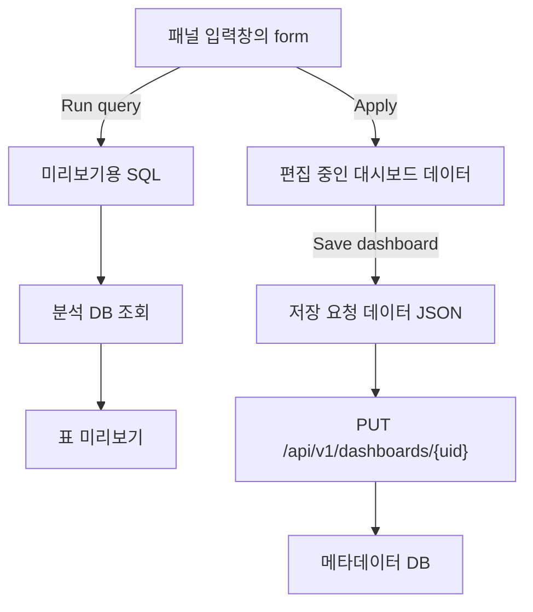



{}
<i class="icon-magic"></i> **AI 요약 & 가이드**

[이전 글](/blog/grafana-clone-3/)에서는 PostgreSQL 데이터를 Table 패널로 표시했습니다.
이번에는 패널 제목과 SQL을 직접 편집하고, 패널을 추가하거나 삭제한 뒤 저장하는 대시보드를 만듭니다.
저장한 패널과 순서가 새로고침 후에도 유지되도록 React 화면과 Go API, PostgreSQL을 연결합니다.

SQL 미리보기, 패널 적용, 대시보드 저장은 각각 다른 상태를 바꿉니다.
Grafana 소스에서 이 구분을 살펴보고, 마지막 저장 결과와 편집 사본을 분리해
여러 패널을 수정하거나 변경을 취소할 수 있는 구조를 구현합니다.

- **[Grafana의 편집과 저장](#grafana의-편집과-저장)**: 편집 전 상태 보관과 SQL 미리보기, 패널 적용, 저장의 차이를 살펴봅니다.
- **[대시보드 데이터와 패널 저장](#대시보드-데이터와-패널-저장)**: 패널 제목과 SQL, 표시 순서를 PostgreSQL JSONB 배열로 저장합니다.
- **[Go 대시보드 저장 API](#go-대시보드-저장-api)**: 입력값 검증과 PUT 요청 처리, DB 업데이트와 오류 응답을 구현합니다.
- **[React 대시보드 편집 화면](#react-대시보드-편집-화면)**: 편집 사본과 미리보기, 패널 추가와 삭제, 순서 변경, 저장과 취소를 연결합니다.
- **[테스트와 실행 검증](#테스트와-실행-검증)**: Go API와 React 상호작용 테스트, TypeScript 검사와 Vite 빌드 결과를 확인합니다.
{}

[이전 글](/blog/grafana-clone-3/)에서는 PostgreSQL에서 조회한 결과를 Table 패널로 표시했습니다.
이번에는 화면에서 패널 제목과 SQL을 바꾸고, 패널을 추가하거나 제거한 뒤 대시보드를 저장합니다.
새로고침해도 같은 패널이 나타나는 것까지 확인합니다.

처음에는 입력창과 저장 버튼을 붙이면 될 것 같았습니다.
그런데 SQL을 입력한 상태, 미리보기를 실행한 상태, 대시보드에 적용한 상태, DB에 저장한 상태는 서로 달랐습니다.
이 차이를 어떻게 다루는지 AI와 함께 Grafana 소스를 읽고, 지금 만든 앱에 필요한 범위로 구현해 봤습니다.

## Grafana의 편집과 저장

### 편집 세션의 원본 상태

편집 화면에서는 현재 상태와 비교할 기준점이 필요합니다. 그래야 편집 중에 무엇이 바뀌었는지 알 수 있고,
사용자가 저장하지 않고 나갈 때 어느 상태를 유지해야 하는지도 정할 수 있습니다.
이번 앱의 `saved`와 `draft`도 이 생각에서 출발했습니다.
마지막으로 저장한 대시보드 데이터를 `saved`에 두고, 화면에서 고치는 데이터는 별도 `draft`로 다룹니다.

Grafana도 편집을 시작하는 순간 대시보드 전체 상태를 복사합니다.
`DashboardScene`의 `onEnterEditMode`는 복사본을 `_initialState`에 넣은 뒤 편집 모드와 변경 추적을 시작합니다.

```tsx
// public/app/features/dashboard-scene/scene/DashboardScene.tsx
export class DashboardScene extends SceneObjectBase<DashboardSceneState> {
  ...
  public onEnterEditMode = (source: 'user' | 'assistant' = 'user') => {
    ...
    this._initialState = sceneUtils.cloneSceneObjectState(this.state, { isDirty: false });
    this._initialUrlState = locationService.getLocation();

    this.setState({ isEditing: true, editable: true });
    this.state.body.editModeChanged?.(true);
    this._changeTracker.startTrackingChanges();
    ...
  };
  ...
}
```

`this.state`는 화면에 표시 중인 대시보드 Scene 전체입니다.
`cloneSceneObjectState()`는 그 상태를 별도 객체로 복사합니다.
`_initialState`는 이 편집 세션이 시작된 시점의 대시보드이며,
이후 변경 사항을 판단하는 대시보드 단위의 기준점입니다.

패널 편집기에도 더 작은 범위의 기준점이 있습니다. 아래처럼 `PanelEditor` 클래스는
패널을 저장용 `Panel` 형태로 바꾼 값과, 패널 위치와 크기를 담은 레이아웃 상태를 따로 보관합니다.

```tsx
// public/app/features/dashboard-scene/panel-edit/PanelEditor.tsx
export class PanelEditor extends SceneObjectBase<PanelEditorState> {
  private _layoutItemState?: SceneObjectState;
  private _layoutItem: DashboardLayoutItem;
  private _originalSaveModel!: Panel;
  ...
  private setOriginalState(panelRef: SceneObjectRef<VizPanel>) {
    const panel = panelRef.resolve();

    this._originalSaveModel = vizPanelToPanel(panel);
    this._layoutItemState = sceneUtils.cloneSceneObjectState(this._layoutItem.state);
  }
  ...
}
```

`_originalSaveModel`은 화면을 그리는 Scene 객체 전체가 아니라,
지금 저장한다면 만들어질 패널 JSON에 해당하는 값입니다.
`setOriginalState()`가 처음 열린 패널의 저장용 모습과 레이아웃 복사본을 함께 채웁니다.

이 기준점은 취소 동작보다 먼저 변경 감지에 쓰입니다. Grafana는 현재 패널도 같은 저장용 형태로 변환한 뒤
`_originalSaveModel`과 비교해, 값이 달라졌을 때만 `isDirty`를 `true`로 둡니다.

```tsx
// public/app/features/dashboard-scene/panel-edit/PanelEditor.tsx
export class PanelEditor extends SceneObjectBase<PanelEditorState> {
  ...
  private _setupChangeDetection() {
    const panel = this.state.panelRef.resolve();
    const performSaveModelDiff = () => {
      this.setState({
        isDirty: !deepEqual(this._originalSaveModel, vizPanelToPanel(panel)),
      });
    };
    ...
  }
  ...
}
```

즉 `setOriginalState()`가 비교 기준을 만들고, `_setupChangeDetection()`가
현재 값과 비교해 변경 여부를 갱신하는 순서입니다. 이번 앱에서는 패널 단위 Scene 객체 대신
`saved`와 `draft`를 각각 저장된 대시보드 데이터와 편집 중인 대시보드 데이터로 둔 것이 이 구조에서 참고한 부분입니다.

`onDiscard`는 이름만 보면 패널 옵션 전체를 원본으로 되돌릴 것 같지만,
Grafana에서 직접 처리하는 범위는 더 좁습니다.

```tsx
// public/app/features/dashboard-scene/panel-edit/PanelEditor.tsx
export class PanelEditor extends SceneObjectBase<PanelEditorState> {
  ...
  public onDiscard = () => {
    this.setState({ isDirty: false });

    const panel = this.state.panelRef.resolve();
    const dashboard = getDashboardSceneFor(this);
    ...
    if (this.state.isNewPanel) {
      dashboard.removePanel(panel);
    } else {
      this._layoutItem!.setState(this._layoutItemState!);
    }

    locationService.partial({ editPanel: null });
  };
  ...
}
```

새 패널이면 대시보드에서 제거하고, 기존 패널이면 보관해 둔 레이아웃 상태를 다시 넣은 뒤 편집기를 닫습니다.
이 메서드에는 `_originalSaveModel`을 패널에 다시 대입하는 코드가 없습니다.
따라서 이번 앱에서는 이 동작 전체를 그대로 옮기지 않았습니다.
대신 저장하지 않은 대시보드 편집 내용을 버릴 때 `draft`를 `saved` 기준으로 다시 만들도록 단순화했습니다.

### 패널 적용과 대시보드 저장

패널 제목과 SQL을 수정한 뒤에는 "수정한 값이 지금 어디에 있는가"를 구분할 필요가 있습니다.
입력창에서 바꾼 값, 표 미리보기에 쓰는 값, 대시보드 화면에 적용한 값,
DB에 저장한 값은 같은 것처럼 보여도 서로 다른 단계입니다.



예를 들어 SQL 입력창에서 `SUM(payment_amount)`를 다른 식으로 바꾼 직후에는 아직 form 안의 문자열만 달라집니다.
이 상태에서 `Run query`를 누르면 그 문자열을 분석 DB에 보내 표 미리보기만 바뀝니다.
미리보기를 확인한 뒤 `Apply`를 눌러야 제목과 SQL이 대시보드 편집 사본에 들어갑니다.
그래도 DB에는 아직 아무 변경이 없습니다.

`Save dashboard`는 한 단계 더 바깥의 동작입니다.
대시보드 제목과 설명, 패널의 제목과 SQL, 배열 순서를 모아 저장 요청 데이터로 만들고 서버에 보냅니다.
서버가 성공 응답을 돌려준 뒤에야 브라우저는 그 결과를 마지막 저장 상태로 삼습니다.
따라서 `Apply` 직후 페이지를 새로고침하면 변경이 사라질 수 있지만,
`Save dashboard`까지 끝낸 뒤 새로고침하면 같은 패널이 다시 나타납니다.

Grafana도 이 경계를 분리합니다. `saving/SaveDashboardForm.tsx`는 저장 대화상자의 입력,
저장 중 상태, 오류와 성공 결과를 다룹니다. `serialization/transformSceneToSaveModel.ts`는
화면을 구성하는 Scene에서 실제로 저장할 대시보드 데이터를 만듭니다.
화면 객체 전체를 그대로 서버에 보내는 대신, 저장에 필요한 값만 골라 별도 모델로 바꾸는 구조입니다.

이번 구현에서는 이 흐름을 세 버튼으로 드러냈습니다.

- `Run query`는 현재 SQL을 한 번 조회해 미리보기를 갱신합니다. 대시보드 편집 사본과 DB는 바꾸지 않습니다.
- `Apply`는 패널 form의 제목과 SQL을 대시보드의 `draft`에 반영합니다. 패널 편집 화면은 닫히지만 DB 요청은 보내지 않습니다.
- `Save dashboard`는 `draft` 전체를 JSON으로 보내 DB에 저장합니다. 성공하면 응답을 `saved`와 새 `draft`의 기준으로 사용합니다.

이 구분 덕분에 SQL을 실험하다가 패널 편집을 취소할 수 있고,
Apply로 여러 패널을 고친 뒤 대시보드 단위로 한 번에 저장할 수도 있습니다.
서버 검증 오류가 나더라도 `draft`를 버리지 않으므로 입력한 값을 고쳐 다시 저장할 수 있습니다.

화면은 Grafana의 패널 미리보기, 아래쪽 쿼리 편집 영역, 오른쪽 패널 옵션 배치를 참고했습니다.
다만 원본의 모든 기능을 구현한 것은 아닙니다. 이번에는 Table과 PostgreSQL 하나만 지원하며,
패널을 드래그하는 대신 위아래 버튼으로 순서를 바꿉니다. 저장 API도 Grafana와 호환되는 API가 아니라 학습용으로 만든 API입니다.



## 대시보드 데이터와 패널 저장

### 패널 목록을 DB로 옮기기

이전에는 프론트엔드 코드에 매출 SQL이 들어 있었습니다. 이제는 대시보드마다 다른 SQL과 패널 목록을 가져야 하므로 `dashboards` 테이블에 `panels` 열을 추가합니다.

```sql
-- db/metadata/003_panels.sql
BEGIN;

CREATE TABLE IF NOT EXISTS schema_migrations (
    name text PRIMARY KEY
);

ALTER TABLE dashboards ADD COLUMN IF NOT EXISTS panels jsonb NOT NULL DEFAULT '[]'::jsonb
    CHECK (jsonb_typeof(panels) = 'array');

UPDATE dashboards
...

COMMIT;
```

`panels`는 패널 객체의 JSON 배열입니다. 각 객체에는 ID, 종류, 제목, SQL이 들어갑니다.
배열의 순서가 화면의 표시 순서가 되므로 순서를 따로 저장하는 열은 만들지 않았습니다.
`CHECK`는 JSON의 최상위 값이 배열인지 검사합니다. 각 패널의 필수 항목은 아래에서 Go 코드로 검사합니다.

기존 매출 조회 SQL은 같은 마이그레이션에서 초기 패널로 옮겼습니다.

```sql
-- db/metadata/003_panels.sql
...
UPDATE dashboards
SET panels = jsonb_build_array(jsonb_build_object(
    'id', 'daily-sales',
    'type', 'table',
    'title', '일별 매출과 영업이익',
    'sql', $query$SELECT
  order_date AS "날짜",
  SUM(payment_amount) AS "매출",
  SUM(profit) AS "영업이익"
FROM analytics.profit_daily(DATE '2026-07-01', DATE '2026-07-31')
GROUP BY order_date
ORDER BY order_date$query$
))
WHERE uid = 'sales-overview' AND panels = '[]'::jsonb
  AND NOT EXISTS (SELECT 1 FROM schema_migrations WHERE name = '003_panels');

INSERT INTO schema_migrations (name) VALUES ('003_panels') ON CONFLICT DO NOTHING;
...
```

`$query$`는 SQL 문자열 안에 날짜의 작은따옴표가 들어 있어도 그대로 적을 수 있게 하는 PostgreSQL 문자열 구분자입니다.
`schema_migrations`에는 적용한 작업의 이름을 남깁니다. 패널이 비었는지만 검사하면 사용자가 모든 패널을 지운 후
마이그레이션을 다시 실행했을 때 샘플이 되살아날 수 있습니다. 적용 기록도 검사해 이를 막았습니다.

기존 Docker 볼륨에는 초기화 SQL이 자동으로 다시 실행되지 않습니다.
데이터는 그대로 두고 다음 명령으로 변경 사항만 적용했습니다.

```bash
docker compose exec -T metadata-db psql -U dashboard_lab -d dashboard_lab \
  -v ON_ERROR_STOP=1 -f /docker-entrypoint-initdb.d/003_panels.sql
```

### 저장할 값과 응답할 값

Go에는 패널 하나를 나타내는 `Panel`과 저장 요청의 본문을 나타내는 `Document`를 추가했습니다.

```go
// backend/internal/dashboard/dashboard.go
type Panel struct {
    ID    string `json:"id"`
    Type  string `json:"type"`
    Title string `json:"title"`
    SQL   string `json:"sql"`
}

type Document struct {
    Title       string  `json:"title"`
    Description string  `json:"description"`
    Panels      []Panel `json:"panels"`
}
```

`Document`에는 사용자가 수정할 수 있는 값만 들어갑니다. UID는 요청 URL에서 읽고 수정 시각은 DB가 정합니다.
응답에 사용하는 기존 `Dashboard`에는 `Panels []Panel`을 추가했고, `Store` 인터페이스에는 저장 메서드를 추가했습니다.

```go
// backend/internal/dashboard/dashboard.go
type Store interface {
    List(context.Context) ([]Dashboard, error)
    GetByUID(context.Context, string) (Dashboard, error)
    Update(context.Context, string, Document) (Dashboard, error)
}
```

`Update`는 요청의 context, 변경할 UID, 새 `Document` 데이터를 받아 저장 결과를 반환합니다.
기존 `List`와 `GetByUID`처럼 Handler는 이 인터페이스인 `Store`를 사용합니다.
즉 HTTP Handler는 "요청을 읽고 응답을 만든다"는 일만 맡고, 실제로 어디에 저장할지는 `Store`가 맡습니다.

## Go 대시보드 저장 API

### 입력값 검증

프론트엔드에 입력 제한이 있어도 HTTP 요청을 직접 보내면 우회할 수 있습니다.
따라서 저장할 대시보드 데이터가 올바른지 서버에서도 검사합니다. 이 검사는 브라우저에서 오는 PUT 요청뿐 아니라,
나중에 다른 Go 코드가 `Store.Update`를 직접 호출하는 경우에도 적용되어야 합니다.
먼저 검증 실패를 표현하는 타입입니다.

```go
// backend/internal/dashboard/dashboard.go
type ValidationError struct{ Message string }

func (e *ValidationError) Error() string { return e.Message }
```

`Error()` 메서드가 있어 `*ValidationError` 값을 일반적인 Go 오류인 `error`로 반환할 수 있습니다.
호출하는 쪽은 오류가 났다는 사실만 처리하면 되고, Handler는 이 오류를 400 응답으로 바꿉니다.
`Document.Validate`는 제목, 설명, 패널 수를 먼저 확인합니다.

```go
// backend/internal/dashboard/dashboard.go
func (d Document) Validate() error {
    invalid := func(message string) error { return &ValidationError{Message: message} }
    if strings.TrimSpace(d.Title) == "" || len([]rune(d.Title)) > 200 {
        return invalid("대시보드 제목은 1~200자로 입력해 주세요.")
    }
    if len([]rune(d.Description)) > 2000 {
        return invalid("설명은 2000자 이내로 입력해 주세요.")
    }
    if d.Panels == nil || len(d.Panels) > 20 {
        return invalid("panels는 최대 20개의 패널을 가진 배열이어야 합니다.")
    }
    ...
}
```

제목은 공백만 입력할 수 없고 길이도 제한합니다.
한글과 같은 유니코드 문자가 포함된 문자열의 길이를 올바르게 구하기 위해서는 `[]rune` 슬라이스로 변환해야 합니다.
패널은 `[]`처럼 빈 배열로 저장할 수 있지만, 누락되거나 `null`인 값은 받지 않습니다.
빈 대시보드를 의도적으로 저장하는 것과 잘못된 요청을 구분하기 위해서입니다.

이어서 각 패널을 검사합니다.

```go
// backend/internal/dashboard/dashboard.go
func (d Document) Validate() error {
    ...
    ids := make(map[string]bool)
    for i, panel := range d.Panels {
        if strings.TrimSpace(panel.ID) == "" || len(panel.ID) > 100 || ids[panel.ID] {
            return invalid("패널 ID는 비어 있거나 중복될 수 없습니다.")
        }
        ids[panel.ID] = true
        if panel.Type != "table" {
            return invalid("현재는 table 패널만 지원합니다.")
        }
        if strings.TrimSpace(panel.Title) == "" || len([]rune(panel.Title)) > 200 {
            return invalid(fmt.Sprintf("%d번째 패널 제목은 1~200자로 입력해 주세요.", i+1))
        }
        if strings.TrimSpace(panel.SQL) == "" || len(panel.SQL) > 20000 {
            return invalid(fmt.Sprintf("%d번째 패널 SQL은 비어 있지 않고 20000바이트 이내여야 합니다.", i+1))
        }
    }
    return nil
}
```

`ids`에는 이미 본 패널 ID를 기록합니다. 같은 ID가 두 번 나오면 어떤 패널을 편집하거나
제거할지 모호해지므로 저장을 거부합니다. SQL은 여기서 길이와 빈 값만 검사합니다.
SQL 실행 가능 여부와 읽기 전용 제한은 이전 글의 query API가 담당합니다.
잘못된 SQL도 대시보드 데이터에 저장될 수 있지만, 실행 시에는 해당 패널에 오류가 표시됩니다.

### 대시보드 데이터 저장

검증을 통과한 대시보드 데이터는 `PostgresStore.Update`에서 PostgreSQL 한 행으로 저장합니다.
`Document`의 `panels`는 Go에서는 `[]Panel` 배열이지만, DB의 `dashboards.panels` 열은 JSONB 타입입니다.
따라서 저장 직전에는 배열을 JSON 문자열로 바꾸고, 읽을 때는 다시 Go 배열로 되돌려야 합니다.

```go
// backend/internal/dashboard/dashboard.go
func (s *PostgresStore) Update(ctx context.Context, uid string, document Document) (Dashboard, error) {
    if err := document.Validate(); err != nil {
        return Dashboard{}, err
    }
    panels, err := json.Marshal(document.Panels)
    if err != nil {
        return Dashboard{}, err
    }
    item := Dashboard{
        UID: uid, Title: document.Title,
        Description: document.Description, Panels: document.Panels,
    }
    ...
}
```

`json.Marshal`은 Go의 패널 슬라이스를 JSON 바이트로 변환합니다. 예를 들어 패널 두 개가 있으면
`[{"id":"...","type":"table",...}, {...}]`처럼 DB에 넣을 수 있는 JSON이 됩니다.
Handler뿐 아니라 `Store` 구현에서도 `Validate`를 호출하므로,
나중에 다른 코드에서 `Store`를 직접 사용해도 같은 검사를 거칩니다. Handler의 검증은 빠른 오류 응답을,
`Store` 구현의 검증은 저장 경로가 늘어나도 규칙을 놓치지 않게 하는 역할을 합니다.

```go
// backend/internal/dashboard/dashboard.go
func (s *PostgresStore) Update(ctx context.Context, uid string, document Document) (Dashboard, error) {
    ...
    err = s.db.QueryRowContext(ctx, `
        UPDATE dashboards SET title = $2, description = $3, panels = $4::jsonb, updated_at = now()
        WHERE uid = $1 RETURNING updated_at
    `, uid, document.Title, document.Description, string(panels)).Scan(&item.UpdatedAt)
    if errors.Is(err, sql.ErrNoRows) {
        return Dashboard{}, ErrNotFound
    }
    return item, err
}
```

`$1`부터 `$4`는 SQL 문자열에 값을 이어 붙이지 않고 드라이버가 안전하게 전달하는 자리표시자입니다.
`$4::jsonb`는 JSON 문자열인 네 번째 값을 PostgreSQL의 JSONB 값으로 해석하라는 뜻입니다.
패널마다 따로 UPDATE하지 않고 제목, 설명, 패널 배열을 한 문장에서 변경하므로, 저장이 성공한 시점에는
세 값이 함께 갱신됩니다.

`RETURNING updated_at`은 DB가 실제로 기록한 시각을 같은 요청에서 돌려줍니다.
`QueryRowContext`를 사용한 이유도 조회용 SELECT라서가 아니라 이 반환값을 `Scan`으로 읽기 위해서입니다.
UID가 없으면 `UPDATE` 대상 행도 없고 `RETURNING` 결과도 없으므로 `sql.ErrNoRows`가 발생합니다.
`PostgresStore`는 이를 대시보드 도메인에서 쓰는 `ErrNotFound`로 바꿔 Handler가 404를 응답할 수 있게 합니다.

조회 방향에서는 반대로 JSON을 Go 값으로 복원합니다.
기존 목록 조회의 `rows.Scan`에 `panels`를 추가한 부분입니다.

```go
// backend/internal/dashboard/dashboard.go
func (s *PostgresStore) List(ctx context.Context) ([]Dashboard, error) {
    ...
    for rows.Next() {
        var item Dashboard
        var panels []byte
        if err := rows.Scan(&item.UID, &item.Title, &item.Description, &item.UpdatedAt, &panels); err != nil {
            return nil, err
        }
        if err := json.Unmarshal(panels, &item.Panels); err != nil {
            return nil, err
        }
        dashboards = append(dashboards, item)
    }
    ...
}
```

SELECT에도 `panels`를 포함합니다. `GetByUID` 역시 `panels`를 읽은 후
`json.Unmarshal(panels, &item.Panels)`로 복원합니다.
따라서 저장 후 새로고침하면 DB의 같은 패널 배열을 다시 받을 수 있습니다.

### 저장 요청과 오류 응답

기존 `newHandler`에 PUT 경로를 추가합니다.

```go
// backend/cmd/api/main.go
func newHandler(store dashboard.Store, runner query.Runner) http.Handler {
    ...
    mux.HandleFunc("PUT /api/v1/dashboards/{uid}", updateDashboard(store))
    ...
}
```

`updateDashboard`의 첫 부분은 JSON 요청을 읽습니다.
이때 크기 제한과 알 수 없는 필드에 대한 검사를 함께 적용합니다.

```go
// backend/cmd/api/main.go
func updateDashboard(store dashboard.Store) http.HandlerFunc {
    return func(w http.ResponseWriter, r *http.Request) {
        r.Body = http.MaxBytesReader(w, r.Body, 512*1024)
        decoder := json.NewDecoder(r.Body)
        decoder.DisallowUnknownFields()
        var document dashboard.Document
        if err := decoder.Decode(&document); err != nil {
            writeError(w, http.StatusBadRequest, "저장할 JSON 형식이 올바르지 않습니다.")
            return
        }
        if err := decoder.Decode(&struct{}{}); err != io.EOF {
            writeError(w, http.StatusBadRequest, "JSON 값은 하나만 전송해 주세요.")
            return
        }
        ...
    }
}
```

요청 본문은 네트워크에서 들어오는 바이트입니다. `decoder.Decode(&document)`가 이를 `Document` 구조체로 옮기고,
그 다음 코드가 이 데이터를 검증하고 저장하는 순서입니다.

`MaxBytesReader`는 읽을 수 있는 본문을 512 KiB로 제한합니다.
`DisallowUnknownFields`는 `Document`에 없는 필드를 보낸 요청을 거부합니다.
첫 번째 `Decode`가 성공해도 뒤에 다른 JSON이 붙어 있을 수 있어 한 번 더 읽습니다.
공백을 제외하고 더 읽을 값이 없다면 `io.EOF`가 반환됩니다.

요청을 읽은 다음에는 대시보드 데이터 검증과 저장을 수행합니다.

```go
// backend/cmd/api/main.go
func updateDashboard(store dashboard.Store) http.HandlerFunc {
    return func(w http.ResponseWriter, r *http.Request) {
        ...
        if err := document.Validate(); err != nil {
            writeError(w, http.StatusBadRequest, err.Error())
            return
        }
        item, err := store.Update(r.Context(), r.PathValue("uid"), document)
        if errors.Is(err, dashboard.ErrNotFound) {
            writeError(w, http.StatusNotFound, "dashboard not found")
            return
        }
        if err != nil {
            writeError(w, http.StatusInternalServerError, "대시보드를 저장하지 못했습니다. 다시 시도해 주세요.")
            return
        }
        writeJSON(w, http.StatusOK, item)
    }
}
```

`r.PathValue("uid")`는 `PUT /api/v1/dashboards/{uid}` 경로에서 실제로 요청한 UID를 꺼냅니다.
따라서 Handler는 JSON 본문에서 대시보드 식별자를 믿지 않고, URL이 가리키는 대시보드만 갱신합니다.

입력 문제는 400, 없는 대시보드는 404, `Store` 오류는 500입니다.
저장에 성공하면 요청을 그대로 되돌리지 않고 수정 시각을 포함한 저장 결과를 반환합니다.
프론트엔드는 이 결과를 새로운 원본으로 사용합니다. 이 방식이면 브라우저가 추측한 시간이 아니라,
서버와 DB가 확정한 상태를 다음 편집의 기준으로 삼을 수 있습니다.

## React 대시보드 편집 화면

### 저장 결과와 편집 사본


화면을 담당하던 `main.tsx`에서 대시보드 상세 화면을 `DashboardEditor.tsx`로 옮겼습니다.
기존 표 그리기와 서식 함수는 `TablePanel.tsx`에 두고,
대시보드 데이터 타입과 공통 함수는 `dashboard.ts`에 모았습니다.
이렇게 나누면 `main.tsx`는 URL에 따라 목록 또는 상세 화면을 고르는 역할만 하고,
`DashboardEditor.tsx`는 대시보드 편집 상태와 화면 전환에 집중할 수 있습니다.
목록에서 상세 화면으로 이동하는 경로는 그대로입니다.

```ts
// frontend/src/dashboard.ts
export type Panel = { id: string; type: 'table'; title: string; sql: string };
export type DashboardDocument = { title: string; description: string; panels: Panel[] };
export type Dashboard = DashboardDocument & { uid: string; updatedAt: string };

export function toDocument(dashboard: DashboardDocument): DashboardDocument {
  return {
    title: dashboard.title,
    description: dashboard.description,
    panels: dashboard.panels.map(({ id, type, title, sql }) => ({ id, type, title, sql })),
  };
}
```

`DashboardDocument`는 서버에 보낼 데이터입니다. 제목, 설명, 패널 배열처럼 사용자가 편집하는 값만 가집니다.
`Dashboard`는 여기에 UID와 수정 시각을 더한 서버 응답 타입입니다.
UID는 어느 대시보드를 저장할지 URL에서 사용하고, 수정 시각은 DB가 저장을 마친 뒤 돌려주는 값입니다.

`toDocument`는 `Dashboard`에서 저장 대상 필드만 고르면서 패널 객체도 새로 만듭니다.
단순히 `const draft = saved`처럼 같은 객체를 함께 가리키면,
편집용 제목을 바꿀 때 마지막 저장 결과까지 같이 바뀔 수 있습니다.
따라서 이 함수는 화면에서 바꿀 사본을 만들고, 서버가 돌려준 원본과 분리하는 경계입니다.

```tsx
// frontend/src/DashboardEditor.tsx
export function DashboardDetail({ uid }: { uid: string }) {
  const [saved, setSaved] = useState<Dashboard>();
  const [draft, setDraft] = useState<DashboardDocument>();
  const [editing, setEditing] = useState(false);
  const [panelEditor, setPanelEditor] = useState<Panel>();
  const [dialog, setDialog] = useState<'save' | 'discard' | undefined>();
  const [removeID, setRemoveID] = useState<string>();
  const [error, setError] = useState('');
  const [saveError, setSaveError] = useState('');
  const [saving, setSaving] = useState(false);
  const [notice, setNotice] = useState('');
  const dirty = !!saved && !!draft && JSON.stringify(toDocument(saved)) !== JSON.stringify(draft);
  ...
}
```

`saved`는 마지막으로 서버가 저장을 확인해 준 대시보드이고 `draft`는 화면에서 작업 중인 사본입니다.
초기 조회가 성공하기 전에는 둘 다 `undefined`이고, 성공하면 `saved`와 `draft`가 각각 채워집니다.
`panelEditor`에 패널이 있으면 목록이나 대시보드 본문 대신 그 패널의 편집 화면을 보여 줍니다. 조회 오류와 저장 오류도 분리했습니다.
저장에 실패했다고 상세 화면 전체를 오류 화면으로 바꾸면 방금 입력한 내용을 확인하거나 고치기 어려워지기 때문입니다.

`dirty`는 저장 결과와 사본이 다른지 나타냅니다. 이번에 다루는 대시보드 데이터는 필드 수가 적고 `toDocument`에서
순서를 고정하므로 JSON 문자열로 비교했습니다. `dirty`가 `true`이면 Save dashboard 버튼과 나가기 확인 대화상자가
"저장하지 않은 변경이 있다"고 판단할 수 있습니다. 모든 JavaScript 객체를 비교하는 범용 방법으로 쓰려는 것은 아닙니다.

기존 GET 요청의 성공 처리에서 두 상태를 초기화합니다.

```tsx
// frontend/src/DashboardEditor.tsx
export function DashboardDetail({ uid }: { uid: string }) {
  ...
  useEffect(() => {
    const controller = new AbortController();
    fetch(`${apiURL}/api/v1/dashboards/${uid}`, { signal: controller.signal })
      .then(readResponse<Dashboard>)
      .then((value) => { setSaved(value); setDraft(toDocument(value)); })
      .catch((reason: Error) => { if (reason.name !== 'AbortError') setError(reason.message); });
    return () => controller.abort();
  }, [uid]);
  ...
}
```

`useEffect` 안의 요청은 `uid`가 처음 정해질 때와 다른 대시보드 UID로 이동할 때 실행됩니다.
성공하면 서버 응답을 `saved`에 두고, `toDocument(value)`로 별도 `draft`를 만듭니다.
따라서 사용자가 수정하기 전에는 두 상태의 내용이 같고,
수정하기 시작하면 `draft`만 바뀝니다. 컴포넌트가 사라지거나 UID가 바뀌면 반환 함수가 이전 요청을 취소합니다.

여기서 처음 사용하는 `readResponse`는 HTTP 실패 응답을 JavaScript 오류로 바꾸는 공통 함수입니다.
`fetch`는 서버가 400이나 500을 반환해도 응답 자체를 받으면 성공한 Promise를 반환하므로 상태 코드를 별도로 확인합니다.

```ts
// frontend/src/dashboard.ts
export async function readResponse<T>(response: Response): Promise<T> {
  if (!response.ok) {
    const body = await response.json().catch(() => null);
    throw new Error(body?.message ?? `요청 실패 (${response.status})`);
  }
  return response.json() as Promise<T>;
}
```

### 패널 편집과 미리보기


`PanelEditor`는 받은 패널을 바로 수정하지 않고 `form`에 복사합니다. 미리보기에 사용하는 SQL은 `preview`에 따로 둡니다.

```tsx
// frontend/src/DashboardEditor.tsx
export function PanelEditor({ panel, onApply, onCancel }: {
  panel: Panel;
  onApply: (panel: Panel) => void;
  onCancel: () => void;
}) {
  const [form, setForm] = useState({ ...panel });
  const [preview, setPreview] = useState({ sql: panel.sql, run: 0 });
  const [error, setError] = useState('');
  ...
}
```

`onApply`와 `onCancel`은 부모가 전달한 함수입니다. 패널 편집기는 입력을 다루고,
편집 결과를 대시보드의 어느 위치에 반영할지는 부모가 결정합니다.
즉 이 컴포넌트는 패널 하나의 임시 입력을 관리하고, `DashboardDetail`은 대시보드 전체의 `draft`를 관리합니다.
`form.sql`을 입력할 때마다 쿼리를 실행하지 않도록 미리보기 상태를 분리했습니다.

```tsx
// frontend/src/DashboardEditor.tsx
export function PanelEditor({ panel, onApply, onCancel }: {
  panel: Panel; onApply: (panel: Panel) => void; onCancel: () => void;
}) {
  ...
  return <main className="dashboard-workspace">
    ...
    <div className="panel-editor-layout">
      <div>
        <section className="panel preview">
          <h2>{form.title || 'New panel'}</h2>
          <PanelData key={preview.run} sql={preview.sql} />
        </section>
        <section className="panel query-editor">
          <div className="panel-heading">
            <h2>Queries</h2>
            <button onClick={() => setPreview({ sql: form.sql, run: preview.run + 1 })}>
              Run query
            </button>
          </div>
          ...
          <label>SQL<textarea spellCheck={false} value={form.sql}
            onChange={(event) => setForm({ ...form, sql: event.target.value })} /></label>
          ...
        </section>
      </div>
      ...
    </div>
  </main>;
}
```

입력창의 `value`는 `form.sql`을 보여 주고, `onChange`는 새 입력값으로 `form`을 갱신합니다.
이 단계에서는 분석 DB 요청도, 대시보드 `draft` 변경도 일어나지 않습니다.
`Run query`를 눌러야 `preview.sql`에 현재 입력값이 들어가고,
`PanelData`가 그 SQL로 query API를 호출합니다.
같은 SQL을 다시 실행해도 새로 조회할 수 있도록 `run`을 증가시켜 `PanelData`의 `key`를 바꿉니다.
이때 React는 새 `key`를 가진 컴포넌트로 보고 미리보기를 다시 만들므로, 기존 정렬과 페이지 상태도 초기화됩니다.

오른쪽 옵션 영역에서는 패널 제목을 수정합니다. 이번에는 시각화 종류를 선택하는 기능 없이 Table로 고정했습니다.

```tsx
// frontend/src/DashboardEditor.tsx
export function PanelEditor({ panel, onApply, onCancel }: {
  panel: Panel; onApply: (panel: Panel) => void; onCancel: () => void;
}) {
  ...
  return <main className="dashboard-workspace">
    ...
    <div className="panel-editor-layout">
      ...
      <aside className="panel panel-options">
        <h2>Panel options</h2><p>Visualization: Table</p>
        <label>Panel title<input value={form.title}
          onChange={(event) => setForm({ ...form, title: event.target.value })} /></label>
        {error && <p role="alert" className="error-message">{error}</p>}
        ...
      </aside>
    </div>
  </main>;
}
```

상단의 `Apply`는 제목과 SQL이 비어 있는지 확인한 후 부모의 함수를 호출합니다. 이 버튼에서는 API를 호출하지 않습니다.
여기까지는 패널을 대시보드 편집 사본에 반영하는 단계이며, DB에 남기는 단계는 뒤의 Save dashboard입니다.

```tsx
// frontend/src/DashboardEditor.tsx
export function PanelEditor({ panel, onApply, onCancel }: {
  panel: Panel; onApply: (panel: Panel) => void; onCancel: () => void;
}) {
  ...
  return <main className="dashboard-workspace">
    <nav className="workspace-toolbar">
      <strong>Edit panel</strong>
      <div className="toolbar-actions">
        <button onClick={onCancel}>Discard panel changes</button>
        <button className="primary" onClick={() => {
          if (!form.title.trim() || !form.sql.trim()) {
            setError('패널 제목과 SQL을 입력해 주세요.'); return;
          }
          onApply(form);
        }}>Apply</button>
      </div>
    </nav>
    ...
  </main>;
}
```

### 패널 적용과 순서 변경


부모의 `onApply`는 같은 ID가 있으면 기존 패널을 교체하고, 없으면 배열 끝에 추가합니다.

```tsx
// frontend/src/DashboardEditor.tsx
export function DashboardDetail({ uid }: { uid: string }) {
  ...
  if (panelEditor) return <PanelEditor key={panelEditor.id} panel={panelEditor}
    onCancel={() => setPanelEditor(undefined)}
    onApply={(panel) => {
      setDraft((current) => current && ({
        ...current,
        panels: current.panels.some((p) => p.id === panel.id)
          ? current.panels.map((p) => p.id === panel.id ? panel : p)
          : [...current.panels, panel],
      }));
      setPanelEditor(undefined);
      setNotice('패널 변경을 적용했습니다. 대시보드를 저장하면 DB에 반영됩니다.');
    }} />;
  ...
}
```

`setDraft`에 함수를 전달하면 React가 보관한 가장 최근의 `current` 값을 받아 다음 사본을 만들 수 있습니다.
`some`은 해당 ID가 있는지 확인하고, `map`은 대상 패널만 바꾼 새 배열을 만듭니다. 추가일 때는 기존 배열 뒤에 새 패널을 붙입니다.
여기서 `panelEditor`를 비우면 패널 편집 화면을 닫고 대시보드로 돌아갑니다. 하지만 이 시점의 변경은 여전히 `draft`에만 있으므로,
상단의 저장을 누르기 전까지는 새로고침으로 사라질 수 있습니다.

추가 버튼은 `crypto.randomUUID()`로 ID를 만들고,
기본 제목 `New panel`과 `SELECT 1 AS "값"`을 가진 패널을 편집기에 전달합니다.
아직 이 시점에는 `draft.panels`에 넣지 않습니다. 추가 화면에서 취소하면 빈 패널이 남지 않습니다.

순서는 `movePanel` 함수로 바꿉니다.

```ts
// frontend/src/dashboard.ts
export function movePanel(panels: Panel[], id: string, offset: number): Panel[] {
  const from = panels.findIndex((panel) => panel.id === id);
  const to = from + offset;
  if (from < 0 || to < 0 || to >= panels.length) return panels;
  const next = [...panels];
  [next[from], next[to]] = [next[to], next[from]];
  return next;
}
```

`offset`에 -1이면 위로, 1이면 아래로 이동합니다. 배열을 복사한 뒤 두 위치의 원소를 맞바꿉니다.
패널 ID는 그대로이고 배열 안의 위치만 달라집니다.
React에서도 `key={panel.id}`를 사용하므로 위치가 바뀌었다고 다른 패널로 취급하지 않습니다.

삭제는 확인 대화상자에서 `filter`로 ID가 다른 패널만 남깁니다.


```tsx
// frontend/src/DashboardEditor.tsx
export function DashboardDetail({ uid }: { uid: string }) {
  ...
  return <main className="dashboard-workspace">
    ...
    {removeID && <Dialog title="Remove panel?" onClose={() => setRemoveID(undefined)}>
      ...
      <div className="dialog-actions">
        <button onClick={() => setRemoveID(undefined)}>Cancel</button>
        <button onClick={() => {
          setDraft({ ...draft, panels: draft.panels.filter((p) => p.id !== removeID) });
          setRemoveID(undefined);
        }}>Remove panel</button>
      </div>
    </Dialog>}
  </main>;
}
```

이 삭제도 아직 DB 삭제가 아닙니다. `filter`가 새 배열을 만들고 그 결과를 `draft`에 넣을 뿐입니다.
따라서 편집을 취소하면 되돌릴 수 있고 대시보드를 저장해야 최종 반영됩니다.

### 패널마다 쿼리 실행하기

이전 표의 정렬, 날짜와 숫자 서식, 총계 행은 그대로 사용합니다. 달라진 부분은 고정 SQL 대신 각 패널의 `sql`을 받아 조회하는 것입니다.

```tsx
// frontend/src/TablePanel.tsx
export function PanelData({ sql }: { sql: string }) {
  const [frame, setFrame] = useState<TableFrame>();
  const [error, setError] = useState<string>();
  useEffect(() => {
    const controller = new AbortController();
    setFrame(undefined);
    setError(undefined);
    fetch(`${apiURL}/api/v1/query`, {
      method: 'POST',
      headers: { 'Content-Type': 'application/json' },
      body: JSON.stringify({ sql }),
      signal: controller.signal,
    })
      ...
    return () => controller.abort();
  }, [sql]);
  ...
}
```

새 쿼리를 시작할 때 이전 데이터와 오류를 비웁니다.
SQL이 바뀌거나 패널이 사라지면 기존 요청을 취소합니다.
응답을 처리하는 부분에서도 취소된 요청인지 확인합니다.

```tsx
// frontend/src/TablePanel.tsx
export function PanelData({ sql }: { sql: string }) {
  ...
  useEffect(() => {
    ...
    fetch(`${apiURL}/api/v1/query`, {
      ...
    })
      .then(async (response) => {
        if (!response.ok) {
          const body = await response.json().catch(() => undefined);
          throw new Error(body?.message ?? '표 데이터를 불러오지 못했습니다.');
        }
        return response.json() as Promise<TableFrame>;
      })
      .then((value) => { if (!controller.signal.aborted) setFrame(value); })
      .catch((reason: Error) => { if (!controller.signal.aborted) setError(reason.message); });
    return () => controller.abort();
  }, [sql]);
  ...
}
```

상태를 각 `PanelData`가 가지고 있으므로 한 패널의 SQL이 실패해도 다른 패널의 표를 지우지 않습니다.
오류, 로딩, 빈 결과를 나누는 마지막 JSX는 기존 방식과 같습니다.

### 저장과 취소


저장 대화상자에는 대시보드 제목과 설명을 입력하는 폼을 둡니다.
브라우저의 기본 `<dialog>`를 작은 컴포넌트로 감쌌습니다.

```tsx
// frontend/src/DashboardEditor.tsx
function Dialog({ title, children, onClose }: {
  title: string; children: ReactNode; onClose: () => void;
}) {
  const ref = useRef<HTMLDialogElement>(null);
  useEffect(() => { ref.current?.showModal(); }, []);
  return <dialog ref={ref} aria-label={title}
    onCancel={(event) => { event.preventDefault(); onClose(); }}>
    <h2>{title}</h2>{children}
  </dialog>;
}
```

`ref`는 실제 dialog DOM 요소를 가리킵니다.
컴포넌트가 나타나면 `showModal()`을 호출하고, Escape로 닫는 요청은 `onClose`로 전달합니다.
부모의 `dialog` 값이 `'save'`일 때만 이 컴포넌트가 화면에 생기고,
값을 `undefined`로 바꾸면 React가 컴포넌트를 제거합니다.
저장 중에는 `onClose`에서 `saving`을 확인해 닫기 동작을 막고 요청이 끝날 때까지 기다립니다.

폼 제출은 브라우저의 기본 페이지 이동을 막고 `save()`를 호출합니다.

```tsx
// frontend/src/DashboardEditor.tsx
export function DashboardDetail({ uid }: { uid: string }) {
  ...
  return <main className="dashboard-workspace">
    ...
    {dialog === 'save' && <Dialog title="Save dashboard"
      onClose={() => { if (!saving) setDialog(undefined); }}>
      <form onSubmit={(event) => { event.preventDefault(); void save(); }}>
        <label>Title<input autoFocus value={draft.title} disabled={saving}
          onChange={(event) => setDraft({ ...draft, title: event.target.value })} /></label>
        <label>Description<textarea value={draft.description} disabled={saving}
          onChange={(event) => setDraft({ ...draft, description: event.target.value })} /></label>
        <p>패널 {draft.panels.length}개의 제목, SQL, 순서를 저장합니다.</p>
        {saveError && <p role="alert" className="error-message">{saveError}</p>}
        <div className="dialog-actions">
          <button type="button" disabled={saving} onClick={() => setDialog(undefined)}>Cancel</button>
          <button className="primary" disabled={saving}>{saving ? 'Saving…' : 'Save'}</button>
        </div>
      </form>
    </Dialog>}
    ...
  </main>;
}
```

폼 안에서 `type`을 생략한 버튼은 제출 버튼입니다. 따라서 Save 버튼은 `form`의 `onSubmit`을 실행하고,
`event.preventDefault()`가 기본 페이지 이동을 막습니다.
취소 버튼에는 `type="button"`을 지정해 저장 요청을 보내지 않도록 했습니다.
`void save()`는 비동기 함수의 Promise를 이벤트 핸들러에서 반환값으로 사용하지 않겠다는 표현입니다.
실제 오류 처리는 `save` 내부에서 합니다.

```tsx
// frontend/src/DashboardEditor.tsx
export function DashboardDetail({ uid }: { uid: string }) {
  ...
  async function save() {
    if (!draft || saving) return;
    setSaving(true); setSaveError('');
    try {
      const result = await fetch(`${apiURL}/api/v1/dashboards/${uid}`, {
        method: 'PUT', headers: { 'Content-Type': 'application/json' },
        body: JSON.stringify(toDocument(draft)),
      }).then(readResponse<Dashboard>);
      setSaved(result); setDraft(toDocument(result)); setDialog(undefined);
      setNotice('대시보드를 저장했습니다.');
    } catch (reason) {
      setSaveError(reason instanceof Error ? reason.message : '저장하지 못했습니다.');
    } finally { setSaving(false); }
  }
  ...
}
```

`PUT` 요청의 본문에는 `toDocument(draft)`만 들어갑니다.
UID는 본문이 아니라 URL의 `{uid}`로 전달하므로, 서버는 어느 대시보드를 바꿀지 경로에서 판단합니다.
성공했을 때만 `saved`를 서버 응답으로 교체하고 `draft`도 그 결과에서 다시 만듭니다.
이때 두 상태가 다시 같아져 `dirty`는 `false`가 됩니다.
실패하면 `draft`와 대화상자를 그대로 두고 오류를 표시하므로 입력을 고쳐 다시 저장할 수 있습니다.
`finally`는 성공과 실패에 관계없이 저장 중 상태를 해제합니다.

대시보드 편집을 취소할 때는 저장 결과로부터 사본을 다시 만듭니다.


```tsx
// frontend/src/DashboardEditor.tsx
export function DashboardDetail({ uid }: { uid: string }) {
  ...
  function exitEdit() {
    if (!saved) return;
    setDraft(toDocument(saved));
    setEditing(false); setDialog(undefined); setNotice('');
  }
  ...
}
```

`Exit edit`는 변경 사항이 있으면 확인 대화상자를 열고 `Discard`를 눌렀을 때 이 함수를 실행합니다.
`setDraft(toDocument(saved))`가 마지막 저장 결과에서 새 사본을 만들기 때문에,
추가, 수정, 삭제, 순서 변경처럼 `draft`에만 있던 변경이 모두 사라집니다.
변경이 없다면 바로 조회 화면으로 돌아갑니다. 추가로 `beforeunload` 이벤트를 등록해 저장하지 않은
변경이 있을 때 새로고침이나 페이지 이탈을 경고합니다. 브라우저가 보여 주는 경고 문구는 앱이 직접 지정하지 못합니다.

## 테스트와 실행 검증

### 대시보드 편집 API 테스트

`dashboard_test.go`에는 빈 패널 배열, 정상 패널, 중복 ID, 비어 있는 SQL, 지원하지 않는 종류,
패널 수 초과를 검사하는 테스트를 추가했습니다.
API 테스트의 가짜 `Store`에도 `Update`를 구현해 HTTP 처리와 실제 DB 연결을 분리했습니다.

저장 API에서는 정상 대시보드 데이터, 빈 패널 목록, 없는 UID, 빈 제목, `null` 패널,
알 수 없는 JSON 필드, 여러 JSON 값, 잘못된 JSON을 테스트합니다.
검사 결과가 400이나 404로 반환되는지 확인하는 것이 목적입니다.
가짜 `Store`를 사용한 테스트만으로 PostgreSQL에 실제 저장되었다고 판단하지는 않고,
아래 브라우저와 API 재조회로 별도로 확인했습니다.

```bash
backend % GOWORK=off go test ./...
ok  github.com/minyeamer/dashboard-lab/backend/cmd/api
ok  github.com/minyeamer/dashboard-lab/backend/internal/dashboard
ok  github.com/minyeamer/dashboard-lab/backend/internal/query
```

### React 상호작용 테스트

이번에는 입력과 버튼 동작이 많아 Vitest, jsdom, React Testing Library를 추가했습니다.
jsdom은 테스트 안에서 DOM 환경을 제공하고, `userEvent`는 입력과 클릭을 발생시킵니다.
실제 Chrome의 배치나 스타일은 뒤의 브라우저 검증에서 확인합니다.

저장 API가 실패하더라도 입력이 남는지 검사하는 테스트입니다.

```tsx
// frontend/src/DashboardEditor.test.tsx
it('retains inputs and reports server validation errors on failed save', async () => {
  const user = userEvent.setup();
  render(<DashboardDetail uid="example" />);
  await user.click(await screen.findByRole('button', { name: 'Edit' }));
  await user.click(screen.getByRole('button', { name: 'Save dashboard' }));
  await user.clear(screen.getByLabelText('Title', { exact: true }));
  await user.type(screen.getByLabelText('Title', { exact: true }), 'New title');
  await user.click(screen.getByRole('button', { name: 'Save' }));
  expect(await screen.findByRole('alert')).toHaveProperty('textContent', '서버 검증 오류');
  expect(screen.getByLabelText('Title', { exact: true })).toHaveProperty('value', 'New title');
});
```

이 테스트의 공통 준비 코드에서는 GET에 초기 대시보드 데이터를 반환하고
PUT에 400과 오류 메시지를 반환하도록 `fetch`를 대체합니다. 따라서 오류를 우연히 발생시키는 것이 아니라,
실패한 상황에서 화면이 어떻게 유지되는지 확인할 수 있습니다.

나머지 테스트는 원본과 사본의 분리 및 순서 변경, SQL 입력 중 조회하지 않고 `Run query`에서 조회하는 동작,
적용한 패널 수정을 `Discard`로 되돌리는 동작을 확인합니다.



{}
```bash
frontend % npm ci

added 145 packages, and audited 146 packages in 2s

26 packages are looking for funding
  run `npm fund` for details

found 0 vulnerabilities
```
{}

{}
```bash
frontend % npm test

> dashboard-lab-frontend@0.0.0 test
> vitest run


 RUN  v4.1.11

 ✓ src/DashboardEditor.test.tsx (4 tests) 227ms
   ✓ isolates draft objects and preserves IDs when reordering 1ms
   ✓ runs SQL only on Run query and applies without saving 86ms
   ✓ discards applied panel edits without touching the saved dashboard 78ms
   ✓ retains inputs and reports server validation errors on failed save 61ms

 Test Files  1 passed (1)
      Tests  4 passed (4)
   Start at  21:21:36
   Duration  687ms (transform 43ms, setup 0ms, import 130ms, tests 227ms, environment 228ms)
```
{}

{}
```bash
frontend % npm run build

> dashboard-lab-frontend@0.0.0 build
> tsc -b && vite build

vite v6.4.3 building for production...
✓ 31 modules transformed.
dist/index.html                   0.40 kB │ gzip:  0.27 kB
dist/assets/index-C-rf7DTP.css    4.30 kB │ gzip:  1.52 kB
dist/assets/index-BLWzOlYN.js   206.93 kB │ gzip: 64.91 kB
✓ built in 368ms
```
{}



React 테스트 4개가 통과했고 TypeScript 검사와 Vite 빌드도 통과했습니다.
개발 도구 의존성도 수정된 버전으로 갱신했으며, 검사 시점의 `npm audit` 결과는 취약점 0개였습니다.
Docker 빌드에 호스트의 `node_modules`가 섞이지 않도록
`.dockerignore`에는 `node_modules`, `dist`, `*.tsbuildinfo`를 제외했습니다.

## React와 Go 개념 정리

### 제어 컴포넌트와 폼 제출

React에서 입력 요소의 `value`를 상태에 연결하고 `onChange`로 갱신하면 제어 컴포넌트라고 부릅니다.
입력값의 기준이 DOM 자체가 아니라 React 상태에 있습니다. 다음 폼은 입력 중인 이름과 제출한 이름을 구분합니다.

```tsx
import { useState } from 'react';

function ItemForm() {
  const [name, setName] = useState('');
  const [submitted, setSubmitted] = useState('');
  return <form onSubmit={(event) => {
    event.preventDefault();
    setSubmitted(name.trim());
  }}>
    <label>이름<input value={name}
      onChange={(event) => setName(event.target.value)} /></label>
    <button type="submit">확인</button>
    <button type="button" onClick={() => setName('')}>초기화</button>
    <p>확인한 이름: {submitted}</p>
  </form>;
}
```

`value`만 지정하고 값을 갱신하지 않으면 사용자가 입력해도 상태의 값으로 되돌아갑니다.
문자열 입력 상태를 `undefined`로 시작했다가 문자열로 바꾸면 비제어 입력에서 제어 입력으로 전환되는
경고가 발생할 수 있어 처음부터 빈 문자열로 시작하는 편이 명확합니다.

`onSubmit`은 버튼 클릭뿐 아니라 입력창에서 Enter로 제출하는 동작도 처리합니다.
`preventDefault()`는 브라우저의 기본 제출 동작을 막을 뿐이며, 입력 검증이나 서버 요청을 대신 수행하지는 않습니다.



### 얕은 복사와 객체 참조

객체를 다른 변수에 대입해도 새 객체가 만들어지지는 않습니다.
전개 구문으로 복사하더라도 한 단계만 복사하므로 내부 객체는 공유될 수 있습니다.

```ts
function updatePrice() {
  const original = { name: 'item', detail: { price: 1000 } };
  const shallow = { ...original };
  shallow.detail.price = 2000;
  console.log(original.detail.price); // 2000

  const independent = { ...original, detail: { ...original.detail } };
  independent.detail.price = 3000;
  console.log(original.detail.price); // 2000
}
```

첫 번째 복사에서는 `detail`이 같은 객체를 가리킵니다.
두 번째처럼 내부 객체도 복사해야 서로 다른 값을 가질 수 있습니다.
배열도 `[...items]`만으로는 배열 안의 객체까지 복사하지 않습니다.

React 상태를 갱신할 때는 기존 객체를 직접 수정하기보다 바뀌는 경로의 객체를 새로 만들어 전달합니다.
모든 값을 무조건 깊게 복사해야 한다는 뜻은 아닙니다. 수정하지 않는 부분은 공유할 수 있지만,
그 부분을 나중에 직접 변경하지 않도록 주의해야 합니다.



### JSON 디코딩과 입력 검증

JSON을 Go 구조체로 읽는 것과 값이 유효한지 확인하는 것은 별개입니다.
문자열을 읽는 데 성공해도 그 문자열이 빈 이름일 수 있습니다.

```go
type ItemInput struct {
    Name string `json:"name"`
}

func decodeItem(reader io.Reader) (ItemInput, error) {
    var item ItemInput
    decoder := json.NewDecoder(reader)
    decoder.DisallowUnknownFields()
    if err := decoder.Decode(&item); err != nil {
        return ItemInput{}, err
    }
    if err := decoder.Decode(&struct{}{}); err != io.EOF {
        return ItemInput{}, errors.New("expected one JSON document")
    }
    if strings.TrimSpace(item.Name) == "" {
        return ItemInput{}, errors.New("name is required")
    }
    return item, nil
}
```

`DisallowUnknownFields`는 구조체에 대응하지 않는 키를 거부하지만 필수값까지 검사하지는 않습니다.
필드가 빠지면 Go의 기본값이 남으므로 별도 검증이 필요합니다.
또 `Decode`는 JSON 스트림에서 다음 값 하나를 읽기 때문에,
요청 하나에 JSON 하나만 받으려면 뒤에 값이 더 없는지도 확인해야 합니다.

이 옵션이 중복 JSON 키 등 모든 애매한 입력을 엄격하게 금지하는 것은 아닙니다.
어떤 요청을 허용할지는 디코더 기능과 애플리케이션의 검증 규칙을 함께 보고 결정해야 합니다.



## 다음 작업

이제 패널을 화면에서 편집하고 저장한 대시보드 데이터를 다시 불러올 수 있습니다.
다만 두 사람이 같은 대시보드를 열고 각각 저장하면, 나중 요청이 먼저 저장한 내용을 덮어쓰게 됩니다.

다음에는 대시보드에 버전을 붙이고 이전 저장 내용을 이력으로 남길 예정입니다.
브라우저가 편집을 시작한 버전과 서버의 현재 버전이 다르면 `409 Conflict`로 알려 주고,
이전 버전을 확인하고 복원하는 흐름까지 구현하려고 합니다.
